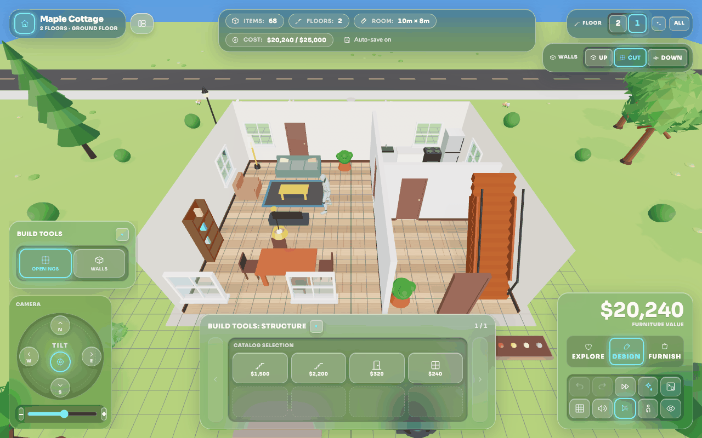

# Three.js Sims-like House Builder

[](https://ch-bas.github.io/threejs-sims-house-builder/)
[](LICENSE)
[](tsconfig.json)
[](https://nextjs.org)

A lightweight, open-source Sims-like house builder that runs entirely in the
browser. Lay out a lot, raise walls, add floors, stairs and a roof, furnish
every room, then walk through it in first person or export the plan for print
and CAD.

Built with Next.js 15, React 18, raw Three.js and Tailwind CSS. No backend and
no account: your house is saved in your browser, and you share it by sending a
link.

**[Open the app](https://ch-bas.github.io/threejs-sims-house-builder/)**



## Features

- **A real building**: up to four floors, each with its own height, straight
  or winder stairs that cut their own stairwells, and a flat, gable or hipped
  roof with dormers.
- **Walls and openings**: exterior and drawn interior walls, doors and windows
  that cut through them, per-wall paint and procedural floor and wall patterns.
- **69 furniture items** in 12 categories, ready-made and your own furniture
  sets, themes, room templates and a budget you can make strict.
- **Editing in 3D and on the 2D plan**: drag with snapping, multi-select,
  groups, align and distribute, copy and paste, locks, and undo/redo for
  everything.
- **A street around the house**: a sloped site, party-wall neighbours, a
  seeded row of houses and a recessed entrance.
- **Walkthrough**: walk the house in first person, up the stairs and out onto
  the street, with a thumb stick on touch screens. Animated people and walkers
  share the house.
- **Light and weather**: a continuous time of day with sun shadows, a night sky
  and lamps, plus rain and snow. Wi-Fi and CCTV coverage overlays.
- **Saving and sharing**: autosave, a saved-house library, share links and
  automatic restore points.
- **Export**: JSON, inventory CSV, PNG, GLB, SVG and DXF plans, and print to
  scale.
- **Phones and tablets**: a docked touch HUD and a bottom-sheet item editor.

## Documentation

The [wiki](https://github.com/ch-bas/threejs-sims-house-builder/wiki) is the
user guide:
[Getting started](https://github.com/ch-bas/threejs-sims-house-builder/wiki/Getting-started),
[Building the house](https://github.com/ch-bas/threejs-sims-house-builder/wiki/Building-the-house),
[Furnishing](https://github.com/ch-bas/threejs-sims-house-builder/wiki/Furnishing),
[Floors and stairs](https://github.com/ch-bas/threejs-sims-house-builder/wiki/Floors-and-stairs),
[The 2D plan](https://github.com/ch-bas/threejs-sims-house-builder/wiki/The-2D-plan),
[Walkthrough](https://github.com/ch-bas/threejs-sims-house-builder/wiki/Walkthrough),
[Phones and tablets](https://github.com/ch-bas/threejs-sims-house-builder/wiki/Phones-and-tablets),
[Saving, sharing and history](https://github.com/ch-bas/threejs-sims-house-builder/wiki/Saving-sharing-and-history),
[Export and print](https://github.com/ch-bas/threejs-sims-house-builder/wiki/Export-and-print),
[Keyboard shortcuts](https://github.com/ch-bas/threejs-sims-house-builder/wiki/Keyboard-shortcuts) and
[FAQ and troubleshooting](https://github.com/ch-bas/threejs-sims-house-builder/wiki/FAQ-and-troubleshooting).

For contributors, the wiki explains the
[Architecture](https://github.com/ch-bas/threejs-sims-house-builder/wiki/Architecture),
[Rendering](https://github.com/ch-bas/threejs-sims-house-builder/wiki/Rendering),
[Data safety](https://github.com/ch-bas/threejs-sims-house-builder/wiki/Data-safety),
[Development and testing](https://github.com/ch-bas/threejs-sims-house-builder/wiki/Development-and-testing) and
[Releasing](https://github.com/ch-bas/threejs-sims-house-builder/wiki/Releasing).
Two references live in the repo because they change with the code:

- [docs/architecture.md](docs/architecture.md): the module layout, file by file.
- [docs/design-notes.md](docs/design-notes.md): why things are built the way
  they are, and the known limitations.

What each release added is in the [changelog](CHANGELOG.md).

## Run it

You need Node.js 22 or newer (see `.nvmrc`).

```bash
npm install
npm run dev          # http://localhost:3000, or 3001 when 3000 is taken
```

The app is a static export (`output: 'export'`), so a production build is a
folder of plain files in `out/`. `next start` can't serve it; use any static
file server:

```bash
npm run build
npm start # serves out/ at http://localhost:3000
```

`GITHUB_PAGES=true npm run build` builds for the GitHub Pages base path
(`/threejs-sims-house-builder/`) instead, which a server at the root can't
serve.

## Contributing

```bash
npm run typecheck                  # tsc --noEmit
npm run lint -- --max-warnings=0   # ESLint, as CI runs it
npm run test                       # the Vitest unit suite
```

CI runs all three on every pull request, and `main` only takes changes through
a pull request that passes them. To add a furniture item, add its catalogue
entry in `components/room-organizer/lib/constants.ts` and a mesh builder in
`components/room-organizer/three/builders/`, registered in
`three/furniture-builders.ts`. [CONTRIBUTING.md](CONTRIBUTING.md) has the rest.

## Module layout

Moved to [docs/architecture.md](docs/architecture.md).

## Design notes

Moved to [docs/design-notes.md](docs/design-notes.md).

## License

[MIT](LICENSE)

### Third-party assets

- `components/room-organizer/assets/people.glb` — mannequin and animations
  from Quaternius' [Universal Animation Library](https://quaternius.itch.io/universal-animation-library),
  CC0 1.0. Thank you, Quaternius. Details in
  [`assets/README.md`](components/room-organizer/assets/README.md).
